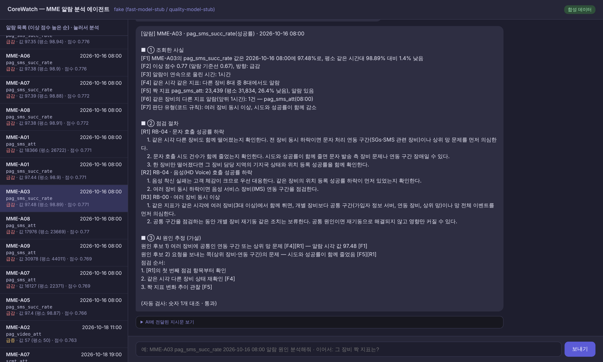
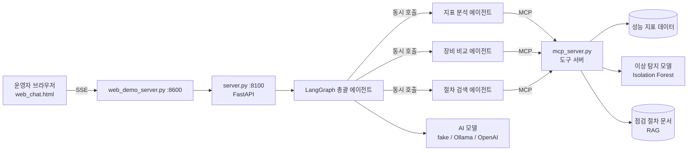
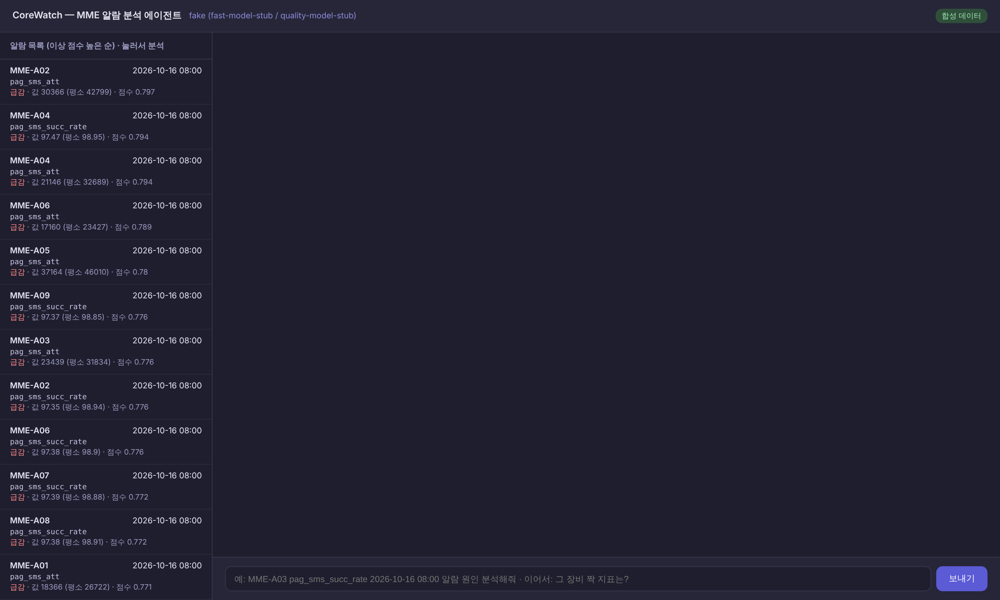
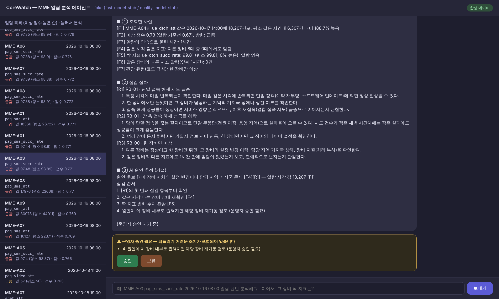
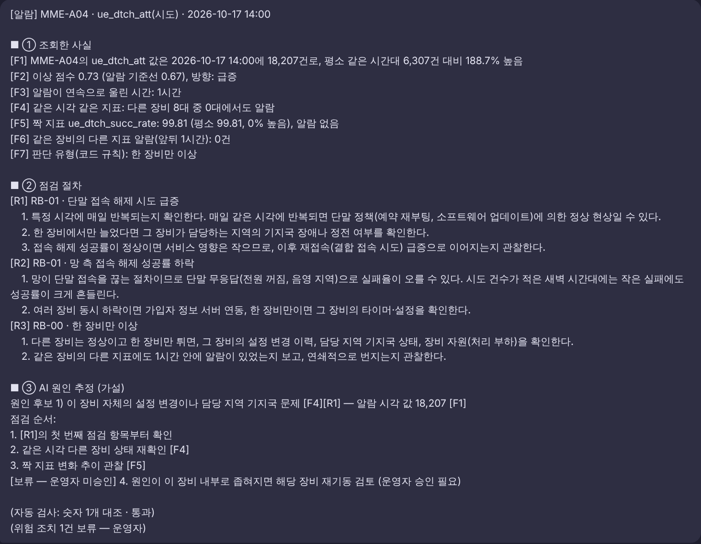
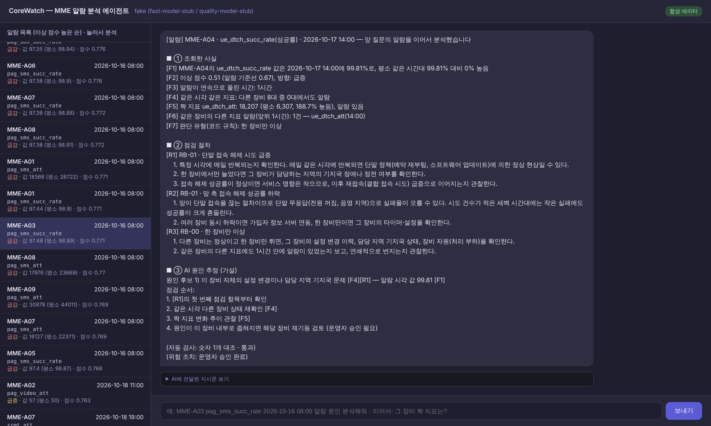

# CoreWatch — 통신망 장비 이상 탐지 및 원인 분석 AI 에이전트

CoreWatch는 이동통신망 핵심 장비의 성능 지표를 지켜보다가 평소와 다른 움직임(이상)을 찾아내고,
운영자가 그 원인을 빨리 판단할 수 있도록 **근거를 직접 모아 분석 리포트를 써 주는 AI 에이전트**입니다.

- 작성: 조종원 (SK AX AI/Data Engineering 1팀) · SKALA AI 서비스 개발 Mini-project (과제 2: 신규 프로젝트)
- 기반 코드: SKALA 제공 Base AI Agent (FastAPI + LangGraph + MCP + SSE)



---

## 1. 프로젝트명 및 주제 선정 배경

- **프로젝트명:** CoreWatch (Core network + Watch)
- 휴대폰이 통신망에 접속하고, 위치를 알리고, 전화·문자를 받을 수 있게 관리하는 장비를 **MME**라고 합니다.
- 운영자는 이 장비들이 처리한 일의 **시도 건수와 성공률**을 매시간 지켜봅니다.
- 실제 운영 현장에서 받은 MME 성능 지표 데이터를 보고, "이상을 찾는 일"과 "왜 그런지 판단하는 일" 모두 사람에게 부담이 크다는 점에서 주제를 정했습니다.

## 2. 해결하고자 하는 문제

| 문제 | 지금의 방식 | CoreWatch |
|---|---|---|
| 지켜볼 숫자가 너무 많음 | 장비 9대 × 지표 26개 = 매시간 234개 값을 사람이 확인 | 머신러닝 모델이 이상 점수를 계산해 **알람 목록**으로 정리 |
| 이상의 원인 판단에 시간이 걸림 | 짝 지표, 다른 장비 상태, 점검 문서를 하나씩 찾아봄 | 에이전트가 세 갈래로 **동시에 조사**해 근거를 모음 |
| AI 답변을 그대로 믿기 어려움 | LLM이 숫자나 근거를 지어낼 수 있음 | 사실·절차는 **코드가** 쓰고, AI 추정은 **수치 검사**를 통과해야 확정 |
| 위험한 조치를 AI가 권할 수 있음 | — | 재기동 같은 조치는 **운영자 승인** 전까지 확정하지 않음 |

## 3. 개발 환경 및 기술 스택

| 구분 | 사용 기술 |
|---|---|
| 언어·환경 | Python 3.12 (3.11 이상 필수), Windows 11 / macOS, uv 가상환경 |
| 백엔드 | FastAPI, Uvicorn, SSE(실시간 진행 표시), SQLite(대화 기록) |
| 에이전트 | LangGraph (StateGraph, 서브그래프, `interrupt` + checkpointer) |
| 도구 연결 | MCP (fastmcp, stdio) — Tool 6개 · Resource 2개 · Prompt 2개 |
| 이상 탐지 | scikit-learn Isolation Forest, pandas |
| 문서 검색(RAG) | 점검 절차 문서 5종, TF-IDF 문자 n-gram (선택: Ollama 임베딩) |
| AI 모델 | fake(테스트용, 외부 호출 없음) / Ollama(로컬) / OpenAI(합성 데이터 전용) |
| 화면 | Vue 3 (CDN), 단일 HTML |
| 테스트·추적 | pytest 28개, LangSmith(선택, 합성 데이터에서만) |

## 4. 시스템 아키텍처



**분석 요청 1건의 흐름**

```
질문 분류 → 계획(질문에서 장비·지표·시각 찾기, 없으면 직전 알람 이어받기 / MCP Prompt로 분석 절차 받기)
  → 조사: 지표 분석 · 장비 비교 · 절차 검색 에이전트 동시 실행 (실패하면 1번 재조사)
  → 판단 유형 분류 (여러 장비 동시 / 한 장비만 / 지속형 / 시도 건수 적음 …)
  → 리포트 작성 (① 사실·② 절차는 코드가, ③ 원인 추정만 AI가)
  → 수치 검사 (불합격이면 이유를 알려 주고 1번 재작성)
  → 운영자 승인 (재기동 같은 위험 조치가 있을 때만 멈춰서 기다림) → 완성
```

**폴더 구조**

```
mme/                데이터 읽기(data.py), 이상 탐지 모델(detect.py), 점검 절차 검색(rag.py)
mcp_server.py       AI가 부르는 도구 모음 (MCP)
agent/graph.py      에이전트 흐름 연결
agent/nodes/        흐름의 각 단계 (분류·계획·조사·판단·작성·검사·승인)
agent/subagents/    조사 담당 에이전트 3개 (각각 작은 LangGraph)
agent/mme_query.py  질문에서 장비·지표·시각 찾기, 이어지는 질문 처리
data/runbooks_mme/  점검 절차 문서 5종
data/synthetic/     합성 데이터와 일부러 넣은 이상 사례 목록
eval/               이상 탐지 모델 평가, 시나리오 실행 점검
tests/              단위 테스트 (pytest)
server.py           백엔드 서버 (포트 8100)
web_chat.html       웹 화면 (web_demo_server.py로 실행, 포트 8600)
```

## 5. 주요 구현 기능

| 기능 | 설명 | 위치 |
|---|---|---|
| 이상 탐지 + 알람 목록 | 네 가지 단서(평소 같은 시간대와 차이, 1시간 전과 차이, 다른 장비와 차이, 짝 지표와의 관계)로 이상 점수 계산 | `mme/detect.py`, `/alarms` |
| MCP 도구 | 지표 조회, 이상 점수, 알람 목록, 주변 상황(짝 지표·같은 시각 다른 장비), 점검 절차 검색 + 문서 Resource + 분석 절차 Prompt | `mcp_server.py` |
| 멀티 에이전트 | 조사를 세 에이전트(각각 2단계 서브그래프)로 나누고 총괄이 동시에 실행, 하나가 실패해도 나머지는 계속 | `agent/subagents/`, `agent/nodes/research.py` |
| RAG | 문서를 절 단위로 나누고 관련 지표를 메타데이터로 달아, 알람 지표와 맞는 절에 가산점 | `mme/rag.py` |
| 3부분 리포트 | ① 조회한 사실 [F#] ② 점검 절차 [R#] ③ AI 원인 추정 (근거 번호 필수) | `agent/nodes/write.py` |
| 수치 검사 | ③에 사실에 없는 숫자, 없는 근거 번호, 점검 순서 누락이 있으면 반려 → 1회 재작성 | `agent/nodes/validate.py` |
| 운영자 승인 (HITL) | ③에 재기동·롤백 같은 조치가 있으면 `interrupt()`로 멈추고 [승인]/[보류] 버튼을 기다림 | `agent/nodes/approve.py` |
| 이어지는 질문 | "그 장비 짝 지표는?"처럼 물으면 직전 알람(장비·시각)을 이어받아 분석 | `agent/mme_query.py` |
| 데이터 보호 | 실제 데이터 모드에서 OpenAI·LangSmith를 켜면 서버가 시작을 거부 | `server.py` |

## 6. 프로그램 실행 방법

**설치 (처음 한 번)**

```powershell
# Windows PowerShell
uv venv -p 3.12 .venv
.venv\Scripts\activate
uv pip install -r requirements.txt
copy .env.example .env
```

```bash
# macOS / Linux
bash sh/setup_venv.sh && cp .env.example .env
```

**실행 (터미널 2개)**

```powershell
# 터미널 1 — 백엔드 (기본은 가짜 AI, 외부 호출 없음)
.venv\Scripts\python.exe server.py
# OpenAI로 실행하려면 먼저:  $env:LLM_BACKEND="openai"   (.env에 OPENAI_API_KEY 필요, 합성 데이터에서만)

# 터미널 2 — 화면
.venv\Scripts\python.exe web_demo_server.py
# 브라우저에서 http://localhost:8600
```

- 왼쪽 알람 목록에서 알람을 누르거나, `MME-A03 pag_sms_succ_rate 2026-10-16 08:00 알람 원인 분석해줘`처럼 입력합니다.
- 이어서 `그 장비 짝 지표는?`, `같은 시각 MME-A05는?`처럼 물을 수 있습니다.

**테스트와 평가**

```powershell
.venv\Scripts\python.exe -m pytest -q                 # 단위 테스트 28개
.venv\Scripts\python.exe eval\run_scenarios.py        # 시나리오 6개 실행 점검
$env:DATA_MODE="original"; .venv\Scripts\python.exe eval\eval_detector.py   # 탐지 모델 평가 (실제 데이터 필요)
```

| `DATA_MODE` | 데이터 | 사용 범위 |
|---|---|---|
| `synthetic` (기본값) | 실제 데이터와 무관하게 새로 만든 합성 데이터 | 외부 AI, 실행 기록 서비스, 공개 시연 |
| `original` | 제공받은 실제 장비 데이터 (엑셀, 저장소에 없음) | 내 컴퓨터 안에서 로컬 AI 모델로만 |

## 7. 테스트 결과 및 실행 화면

**단위 테스트: 28개 통과** (합성 데이터 + 가짜 AI, 외부 호출 없음)

| 파일 | 개수 | 확인 내용 |
|---|---|---|
| `test_mme_query.py` | 5 | 질문에서 장비·지표·시각 찾기 |
| `test_tools.py` | 5 | MCP 도구 응답 |
| `test_validate.py` | 6 | 수치 검사 (지어낸 숫자·없는 근거 번호 반려) |
| `test_graph.py` | 3 | 전체 흐름, 일반 대화, 정보 부족 |
| `test_followup_hitl.py` | 8 | 이어지는 질문, 위험 조치 감지, 승인 대기 → 재개 |
| `test_openai_backend.py` | 1 | OpenAI 백엔드 연결 (가짜 응답, 과금 없음) |

**시나리오 실행 점검** (`eval/run_scenarios.py`, 합성 데이터에 넣어 둔 이상 사례)

| 시나리오 | 분석한 알람 | 판단 유형 | 수치 검사 | 위험 조치 |
|---|---|---|---|---|
| 여러 장비 문자 호출 성공률 하락 | MME-A03 · pag_sms_succ_rate · 10-16 08:00 | 여러 장비 동시 이상, 시도와 성공률이 함께 감소 | 2회 (1차 반려) | 없음 |
| 한 장비 접속 해제 시도 급증 | MME-A04 · ue_dtch_att · 10-17 14:00 | 한 장비만 이상 | 2회 (1차 반려) | 승인 필요 1건 |
| 이어지는 질문 "그 장비 짝 지표는?" | MME-A04 · ue_dtch_succ_rate · 10-17 14:00 | 한 장비만 이상 | 2회 (1차 반려) | 승인 필요 1건 |
| 한 장비 위치 등록 성공률 하락 | MME-A07 · comb_tau_succ_rate · 10-17 04:00 | 한 장비만 이상, 성공률만 하락 | 2회 (1차 반려) | 승인 필요 1건 |
| 여러 장비 서비스 요청 시도 급증 | MME-A02 · srmt_att · 10-18 19:00 | 여러 장비 동시 이상 | 2회 (1차 반려) | 없음 |
| 새 대화에서 장비 없이 질문 | — | 정보 요청 안내 | — | — |

> 가짜 AI는 1차 작성에 일부러 사실에 없는 숫자(37.5)를 넣습니다. 수치 검사가 이를 잡아 반려하는지 확인하기 위한 장치입니다.

**이상 탐지 모델 평가** (실제 데이터, 7일 시간별 · 앞 3일 학습 / 1일 모델 선택 / 마지막 3일 1회 평가, 학습 기간 알람 비율 0.3%로 통일)

| 방법 | 평가 기간 이상 29건 중 찾은 수 | 잘못 울린 알람 |
|---|---|---|
| 고정 기준 (하루 종일 같은 정상 범위) | 10건 | 22건 |
| 시간대별 평소값 | 17건 | 41건 |
| **머신러닝 (Isolation Forest)** | **20건** | 66건 |

**실행 화면**

| 알람 목록 | 진행 단계 (수치 검사 반려 → 재작성) |
|---|---|
|  |  |

| 운영자 승인 대기 | 보류 후 확정된 리포트 |
|---|---|
|  |  |

| 이어지는 질문 |
|---|
|  |

## 8. 기존 프로젝트(Base) 대비 변경점

| 항목 | Base AI Agent | CoreWatch |
|---|---|---|
| 대상 | 가짜 웹 서비스 6개 상태 | MME 장비 9대 × 지표 26개, 시간별 데이터 |
| 도구 (MCP) | 모니터링 조회 1개 | 지표·이상 점수·알람·주변 상황·절차 검색 등 6개 |
| 문서 선택 | 키워드 규칙 (latency → 문서 A) | RAG 검색 + 지표 메타데이터 가산점 |
| 조사 | 단일 노드에서 병렬 작업 | 서브그래프 3개(멀티 에이전트), 실패 격리 |
| 답변 검사 | "30자 이상 + '1)' 포함" 형식 검사 | 숫자·근거 번호 대조 내용 검사 |
| 리포트 | 자유 형식 | 사실 / 절차 / AI 추정 3부분 분리 |
| 사람 개입 | 없음 | 위험 조치 운영자 승인 (HITL) |
| 대화 | 이름 기억 | 직전 알람을 이어받는 질문 |
| 화면 | 채팅만 | 알람 목록 + 진행 단계 + 승인 버튼 |
| 테스트 | 없음 | pytest 28개 + 시나리오 점검 |

## 9. 개발 과정에서의 문제점 및 해결 방법

| 문제 | 원인 | 해결 |
|---|---|---|
| 진행 표시가 `Called get_config outside of a runnable context` 오류로 실패 | Python 3.10에서는 LangGraph 비동기 노드에 실행 정보가 전달되지 않음 | Python 3.12로 고정, README에 3.11 이상 필수로 명시 |
| 매일 같은 시각 반복되는 정상 패턴까지 이상으로 잡힘 | "평소 같은 시간대" 계산이 해당 시각 하나만 봐서 흔들림 | 앞뒤 1시간(h-1, h, h+1)을 함께 보고, 다른 장비의 변동 폭을 하한으로 사용 |
| 성공률 지표가 0.1%만 흔들려도 알람 | 성공률은 평소 변동이 아주 작아 점수가 과하게 커짐 | 변동 폭 하한(scale floor) 적용 |
| AI가 사실에 없는 숫자를 만들어 냄 | LLM 특성 | 사실·절차는 코드가 쓰고, AI 추정은 숫자·근거 번호 대조 후 재작성 |
| 정답(이상 여부)이 모델 선택에 섞일 위험 | 같은 기간으로 고르고 평가하면 성능이 부풀려짐 | 시간 순서로 학습/선택/평가 분리, 평가는 1회만, 정답은 `eval/`에서만 읽음 |
| 합성 데이터 지표 이름이 실제와 달라 도구가 실패 | 생성기 이름 규칙 차이 | 생성기를 실제 이름 규칙에 맞춤 |
| Windows에서 설치·문서 읽기가 `cp949` 오류 | 한글 파일을 시스템 기본 인코딩으로 읽음 | requirements.txt를 영문만으로, 파일 읽기는 모두 `encoding="utf-8"` |
| 실제 데이터가 외부로 나갈 위험 | 외부 AI·실행 기록 서비스 사용 | 실제 데이터 모드 + OpenAI/LangSmith 조합은 서버가 시작 거부, 데이터 파일은 Git 제외 |

## 10. 한계점 및 향후 개선 방향

| 한계 | 개선 방향 |
|---|---|
| 잘못 울린 알람이 많음 (평가 기간 66건) — 더 많이 찾는 대신 오탐을 받아들인 선택 | 같은 시각 여러 장비 알람을 하나로 묶기, 운영자 피드백으로 기준선 조정 |
| 하루 패턴이 일정하지 않은 지표에서 놓침 (놓친 9건 중 6건) | 지표 유형별 모델 분리, 더 긴 기간 데이터 확보 |
| 데이터가 7일뿐이라 요일 패턴을 볼 수 없음 | 수 주 이상 데이터로 요일·휴일 반영 |
| 실제 AI 모델의 리포트 품질을 정량 평가하지 못함 (시연은 가짜 AI) | Ollama·OpenAI로 같은 시나리오를 돌려 수치 검사 통과율·근거 정확도 측정 |
| 수치 검사는 숫자와 근거 번호만 보고, 문장의 논리가 맞는지는 보지 않음 | 근거 문장과 추정 문장을 대조하는 2차 검사 추가 |
| 점검 절차 문서 5종은 3GPP 표준을 바탕으로 작성자가 정리한 교육용 | 실제 운영 매뉴얼 연동 |
| 승인 대기 상태를 메모리에 보관해 서버를 다시 켜면 사라짐 | SQLite·Redis checkpointer로 교체 |
| 단일 사용자 로컬 실행 | 인증, 다중 사용자, 컨테이너 배포 |

## 데이터 사용 원칙

- 실제 장비 데이터 파일(`*.xlsx`, `*.p`)은 저장소에 올리지 않습니다. 저장소 바깥의 `../Data/` 폴더에 두고 사용합니다.
- 실제 데이터로 실행할 때는 외부 AI 서비스와 실행 기록 서비스를 쓰지 않습니다.
- 데이터의 정답 표시(이상 여부)는 모델 평가에서만 읽습니다. 에이전트는 정답을 보지 않고 판단합니다.
- 화면 캡처와 시연은 모두 합성 데이터로 했습니다.
