<p align="center">
  <picture>
    <source media="(prefers-color-scheme: dark)" srcset="docs/images/logo_dark.png">
    
  </picture>
</p>

<p align="center"><b>통신망 핵심 장비(MME)의 장애 징후를 찾고, 원인 판단 근거를 AI가 모아 리포트로 써 주는 코어망 관제 서비스</b></p>

<p align="center">
  
  
  
  
  
  
  <br>
  
  
  
  
  
  
</p>

<p align="center">
  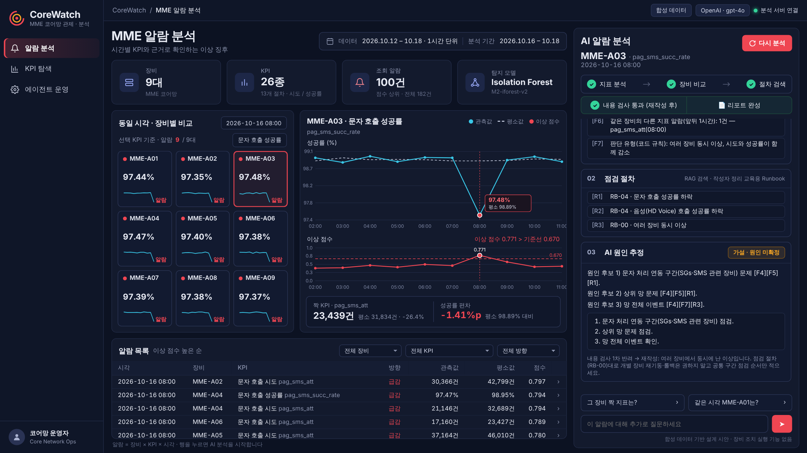
</p>

| 번호 | 성함 | 소속 | 과제 유형 |
|---|---|---|---|
| (번호) | 조종원 | SK AX AI/Data Engineering 1팀 | 과제 2 — 신규 프로젝트 (SKALA Base AI Agent 기반 확장) |

---

## 목차

1. [진행 사항 소개](#1-진행-사항-소개)
2. [사용한 기술 요소 및 구현 결과](#2-사용한-기술-요소-및-구현-결과)
3. [느낀 점 및 향후 개선 사항](#3-느낀-점-및-향후-개선-사항)
4. [실행 방법](#4-실행-방법)
5. [개발 환경 · 폴더 구조 · 데이터 사용 원칙](#5-개발-환경--폴더-구조--데이터-사용-원칙)

---

## 1. 진행 사항 소개

### 1-1. 선정한 프로젝트 주제

**CoreWatch (Core network + Watch)** — MME 장애 징후 탐지 및 원인 분석 AI 에이전트

- 휴대폰이 통신망에 접속하고, 위치를 알리고, 전화·문자를 받을 수 있게 관리하는 장비를 **MME**라고 합니다.
- 운영자는 이 장비들이 처리한 일의 **시도 건수와 성공률**을 매시간 지켜봅니다.
- 실제 운영 현장의 MME 성능 지표 데이터를 보고, "이상을 찾는 일"과 "왜 그런지 판단하는 일" 모두 사람에게 부담이 크다는 점에서 주제를 정했습니다.
- 고객사(가상) 코어망 운영팀과 계약해 납품하는 **B2B 사업 형태**로 기획·개발·결과 보고까지 진행했습니다.

**해결하려는 문제**

| 문제 | 지금의 방식 | CoreWatch |
|---|---|---|
| 지켜볼 숫자가 너무 많음 | 장비 9대 × 지표 26개 = 매시간 234개 값을 사람이 확인 | 머신러닝이 '평소와 다른 정도'를 점수로 매겨 **알람 목록**으로 정리 |
| 원인 판단에 시간이 걸림 | 연관 지표, 다른 장비 상태, 점검 매뉴얼을 하나씩 찾아봄 | 분야별 AI 담당자 3명이 **동시에 조사**해 근거를 모음 |
| AI 답변을 그대로 믿기 어려움 | AI가 숫자나 근거를 지어낼 수 있음 | 사실·매뉴얼은 **시스템이** 쓰고, AI 추정은 **자동 검사**를 통과해야 확정 |
| 위험한 조치를 AI가 권할 수 있음 | — | 장비 재시작 같은 조치는 **운영자 승인** 전까지 확정하지 않음 |

### 1-2. 주요 Task

| # | Task | 내용 | 상태 |
|---|---|---|---|
| 1 | 장애 징후 탐지 | Isolation Forest로 이상 점수 계산, 알람 목록 API | 완료 |
| 2 | 근거 조사 (멀티 에이전트) | 지표 분석 · 장비 비교 · 매뉴얼 검색 담당 3개 서브그래프를 동시 실행, 실패 시 재조사 | 완료 |
| 3 | 데이터 도구 (MCP) | Tool 6개 · Resource 2개 · Prompt 2개 도구 서버 | 완료 |
| 4 | 점검 매뉴얼 검색 (RAG) | 매뉴얼 5종을 절 단위로 나누고 지표 정보로 가산점 | 완료 |
| 5 | 3구역 분석 리포트 | ① 확인된 사실 ② 점검 매뉴얼 ③ AI 원인 추정 (근거 번호 필수) | 완료 |
| 6 | 자동 검사 → 재작성 | 숫자 · 근거 번호 · 매뉴얼 위반을 반려하고 다시 쓰게 함 | 완료 |
| 7 | 운영자 승인 (HITL) | 위험 조치가 있으면 멈추고 [승인]/[보류]를 기다림 | 추가 수행 |
| 8 | 관제 대시보드 | 장비 9대 비교 · 추이 그래프 · 알람 표 · AI 분석 패널 · KPI 탐색 · 에이전트 운영 | 추가 수행 |
| 9 | 운영 관리 | LangSmith 실행 기록 · 자동 피드백, 운영 지표 `/metrics` | 추가 수행 |
| 10 | 검증 | 기능 시험 33개, 실제 AI(gpt-4o) 반복 실행, 탐지 성능 평가 | 완료 |

### 1-3. 수행 과정 (시간 순)

| 일자 | 단계 | 한 일 | 산출물 |
|---|---|---|---|
| 10. 17. (토) | 사전 분석 · 설계 | 운영 데이터 구조와 이상 패턴 분석, 탐지 방식 후보 3종(고정 기준 · 시간대별 기준 · Isolation Forest) 선정, 설계 결정 19건 기록 | 설계 결정 기록(ADR) |
| 10. 20. (화) | 착수 | 사업 제안서 · 사업수행계획서 · 요구사항 정의서 작성, 과제 2 선정, Base 에이전트 구조 분석, 시연용 합성 데이터 생성기 작성 | 착수 문서 3종 v0.9 |
| 10. 21. (수) | 핵심 기능 구축 | 장애 징후 탐지 모델, MCP 도구 서버, 조사 담당 3개(멀티 에이전트), 매뉴얼 검색(RAG), 자동 검사, 운영자 승인, 이어지는 질문, 운영 지표 | 분석 에이전트 · 단위 테스트 |
| 10. 22. (목) 새벽 | 실제 AI 검증 · 관제 화면 | gpt-4o로 시나리오 반복 실행 → 매뉴얼 위반 '장비 재시작' 권고 발견 → 검사 규칙 추가, 관제 대시보드 구축 | 검증 결과 · 관제 화면 |
| 10. 22. (목) 오전 | 운영 준비 · 결과 보고 | Mac · Windows 원클릭 실행 스크립트, LangSmith 실행 기록 · 자동 피드백 연동, README · 발표 자료 작성 | 결과 보고서 · 발표 자료 |

**착수 단계 산출물** — 실제 사업처럼 제안서 → 수행계획서 → 요구사항 정의서 순으로 범위를 정하고, 구축과 검증은 이 문서를 기준으로 진행했습니다.

<p align="center">
  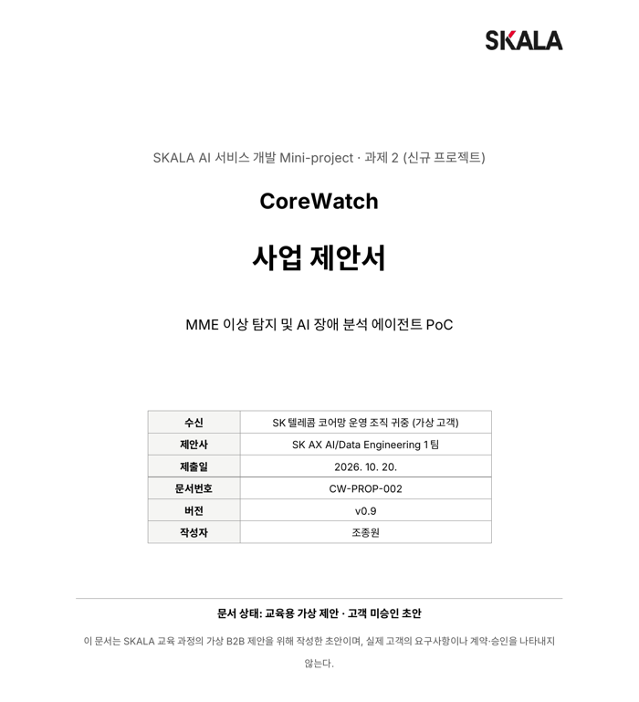&nbsp;
  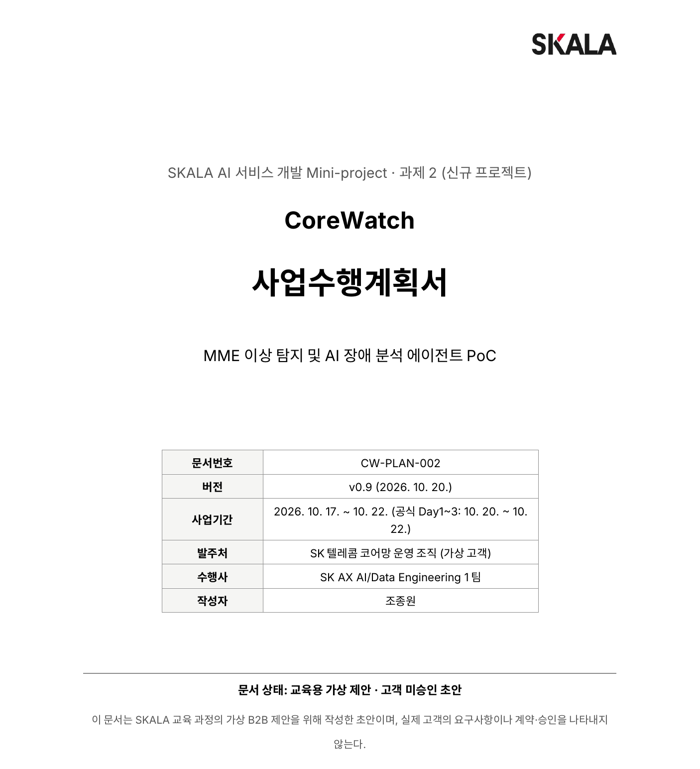&nbsp;
  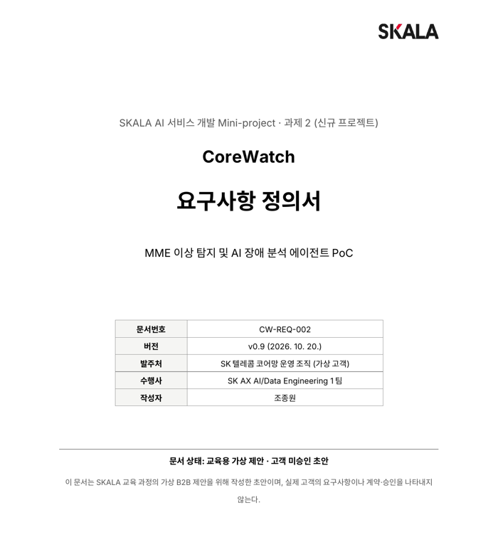
</p>
<p align="center"><sub>사업 제안서 (CW-PROP-002) · 사업수행계획서 (CW-PLAN-002) · 요구사항 정의서 (CW-REQ-002) — 모두 v0.9, 교육용 가상 사업</sub></p>

---

## 2. 사용한 기술 요소 및 구현 결과

### 2-1. 실제 적용한 기술 요소

| 기술 요소 | 어떻게 적용했나 | 위치 |
|---|---|---|
| **Multi-Agent** | 총괄 에이전트(LangGraph StateGraph)가 조사 담당 3개(각각 2단계 서브그래프)를 `asyncio.gather`로 동시 실행. 하나가 실패해도 나머지 결과로 계속 진행하고, 부족하면 1번 재조사 | `agent/graph.py`, `agent/subagents/`, `agent/nodes/research.py` |
| **MCP** | fastmcp(stdio) 도구 서버. 지표 조회 · 이상 점수 · 알람 목록 · 주변 상황 · 매뉴얼 검색 등 **Tool 6개**, 매뉴얼 문서 **Resource 2개**, 분석 절차 **Prompt 2개**. 에이전트는 MCP를 통해서만 데이터에 접근 | `mcp_server.py`, `agent/mcp_client.py` |
| **RAG** | 점검 매뉴얼 5종(RB-00~04)을 절 단위로 나누고 관련 지표를 메타데이터로 보관. TF-IDF 문자 n-gram 검색 + 알람 지표와 맞는 절에 가산점 | `mme/rag.py`, `data/runbooks_mme/` |
| **의존성 주입** | LLM · MCP 클라이언트 · 세션 저장소를 `SupervisorDeps` 하나에 담아 `functools.partial`로 각 노드에 주입. 테스트에서는 가짜 LLM으로 갈아 끼워 외부 호출 없이 검증 | `agent/deps.py`, `agent/graph.py` |
| **LangSmith** | 분석 1건을 `corewatch_analysis` 실행 기록 하나로 묶어 노드 · 서브에이전트 · MCP 도구 · LLM 호출을 계층으로 기록. 끝나면 **자동 피드백**(content_check, first_pass, operator_approval)을 달고 화면에 실행 기록 링크 표시. 합성 데이터에서만 켜짐 | `agent/observability.py`, `/trace/status` `/trace/link` |
| **모듈화** | 데이터 · 탐지 · 검색(`mme/`), 도구 서버(`mcp_server.py`), 흐름 단계별 노드(`agent/nodes/`), 조사 담당(`agent/subagents/`), LLM 백엔드 선택(`agent/llm_factory.py`: fake / Ollama / OpenAI)으로 분리 | 폴더 구조는 [5장](#5-개발-환경--폴더-구조--데이터-사용-원칙) |
| **단위 테스트** | pytest 33개, 가짜 AI로 외부 호출 없이 실행. 가짜 AI는 1차 작성에 일부러 없는 숫자(37.5)를 넣어 자동 검사가 잡는지 확인 | `tests/` |
| **Human-in-the-Loop** | 원인 추정에 재시작 · 롤백 같은 조치가 있으면 LangGraph `interrupt()` + checkpointer로 멈추고 운영자 응답 후 재개 | `agent/nodes/approve.py` |
| **머신러닝 탐지** | Isolation Forest. 평소 같은 시간대 · 1시간 전 · 다른 장비 · 연관 지표 4가지와의 차이로 이상 점수 계산 | `mme/detect.py` |
| **SSE 스트리밍** | 진행 단계 · 리포트 · 실행 기록 링크를 실시간으로 화면에 전달 | `server.py`, `web_chat.html` |

**분석 요청 1건의 흐름**

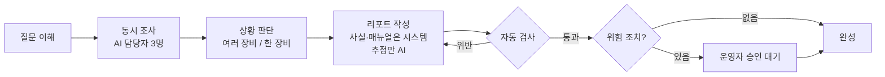

**시스템 아키텍처**

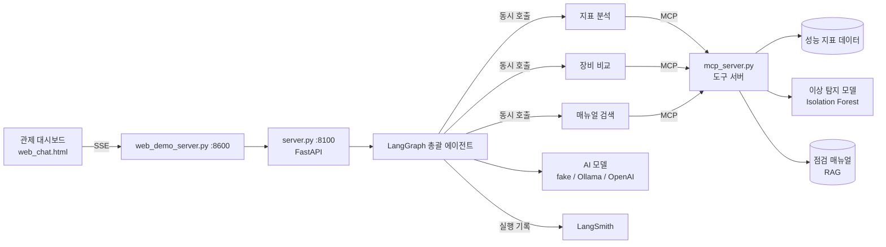

### 2-2. 기존 기능(Base) 대비 개선 사항 및 추가 구현

| 항목 | Base AI Agent | CoreWatch |
|---|---|---|
| 대상 | 가짜 웹 서비스 6개 상태 | MME 장비 9대 × 지표 26개, 시간별 데이터 |
| 도구 (MCP) | 모니터링 조회 1개 | 지표 · 이상 점수 · 알람 · 주변 상황 · 매뉴얼 검색 등 6개 |
| 문서 선택 | 키워드 규칙 (latency → 문서 A) | RAG 검색 + 지표 메타데이터 가산점 |
| 조사 | 단일 노드에서 병렬 작업 | 서브그래프 3개(멀티 에이전트), 실패 격리 · 재조사 |
| 답변 검사 | "30자 이상 + '1)' 포함" 형식 검사 | 숫자 · 근거 번호 · 매뉴얼 위반 내용 검사 후 재작성 |
| 리포트 | 자유 형식 | 사실 / 매뉴얼 / AI 추정 3구역 분리 |
| 사람 개입 | 없음 | **추가:** 위험 조치 운영자 승인 (HITL) |
| 대화 | 이름 기억 | **추가:** 직전 알람을 이어받는 질문 ("그 장비 짝 지표는?") |
| 화면 | 채팅창 하나 | **추가:** 관제 대시보드 (장비 비교 · 추이 · 알람 표 · AI 패널 · KPI 탐색 · 에이전트 운영) |
| 운영 관리 | 없음 | **추가:** LangSmith 실행 기록 · 자동 피드백, `/metrics` |
| 데이터 보호 | 없음 | **추가:** 실제 데이터 + 외부 AI/LangSmith 조합이면 서버가 시작 거부 |
| 테스트 | 없음 | pytest 33개 + 실제 AI 반복 점검 |

### 2-3. 구현한 기능별 화면 캡처

> 화면의 AI 리포트는 로컬 PC에서 실행한 실제 gpt-4o 응답입니다 (합성 데이터).

**① 관제 대시보드 첫 화면 — 요약 지표 · 장비 9대 비교 · 추이 그래프 · 알람 목록**

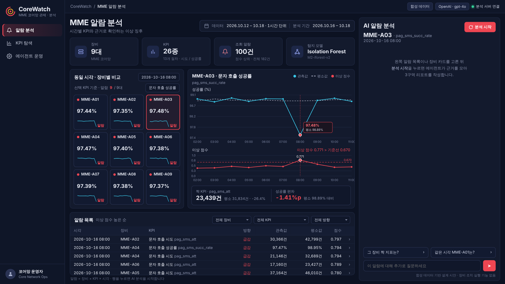

**② 3구역 리포트 (① 확인된 사실 · ② 점검 매뉴얼)**

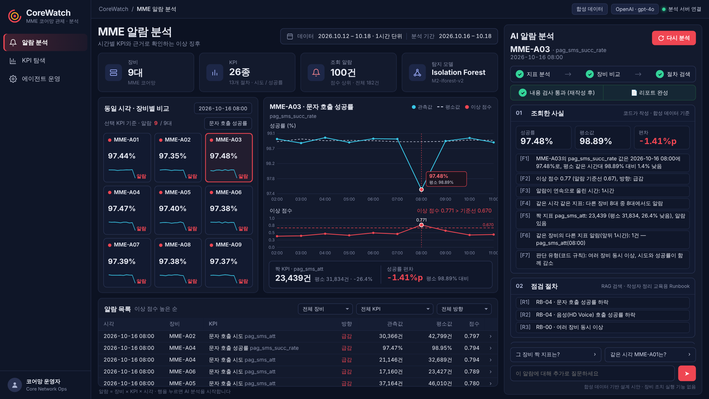

| ③ 자동 검사: 재시작 권고 반려 → 재작성 | ④ 한 장비 이상: 위험 조치 → 운영자 승인 대기 |
|---|---|
| 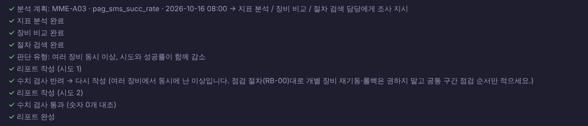 | 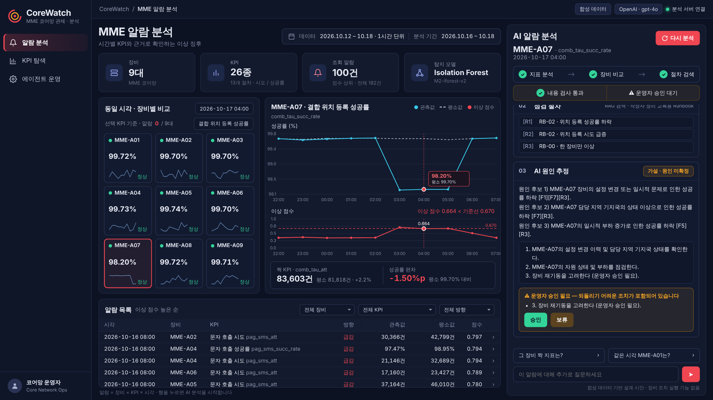 |

| ⑤ 운영자 승인 후 확정된 리포트 | ⑥ 이어지는 질문 "그 장비 짝 지표는?" |
|---|---|
| 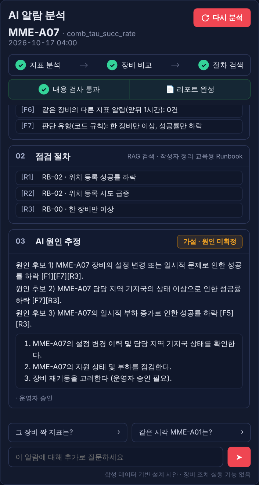 | 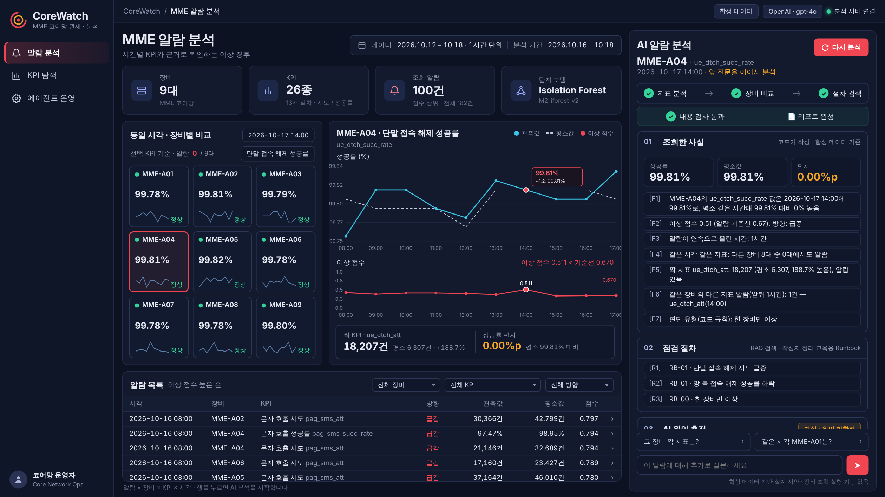 |

**⑦ KPI 탐색 — 전체 기간 그래프 · 알람 표**

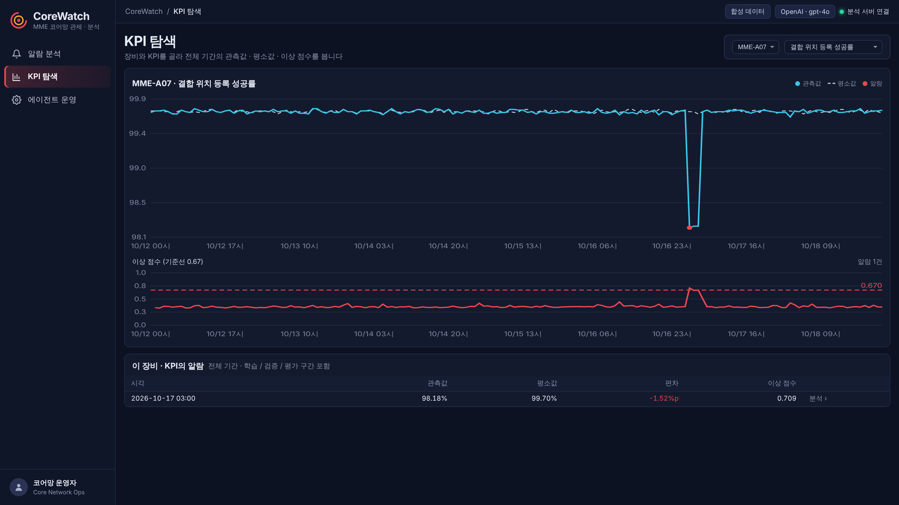

**⑧ 에이전트 운영 — 운영 지표(/metrics) · LangSmith 실행 기록과 자동 피드백**

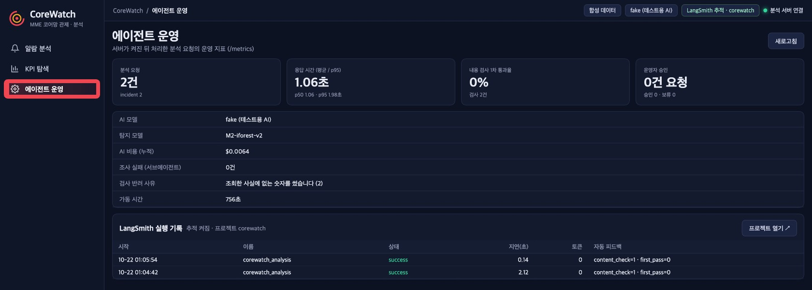

### 2-4. 검증 결과

**실제 AI(gpt-4o) 반복 실행** — 합성 데이터의 장애 상황 6개 시나리오를 실제 OpenAI 모델로 3번씩 실행 (`eval/run_scenarios.py --repeat 3`). 전체 표와 리포트 전문은 [`docs/results/`](docs/results/)에 있습니다.

| 항목 | 1차 실행 (규칙 추가 전) | 2차 실행 (규칙 추가 후) |
|---|---|---|
| 리포트 작성 | 15건 | 15건 |
| 1차 작성 바로 통과 | 15건 (100%) | 9건 (60%) |
| 자동 검사 최종 통과 | 15건 (100%) | 15건 (100%) |
| **여러 장비 동시 이상인데 AI가 "장비 재시작"을 권한 리포트** | **6건 중 6건** (승인 단계에서 멈춤) | **0건** (검사가 6건 모두 반려 → 재작성) |
| 운영자 승인 요청 | 9건 | 4건 (한 장비 이상에서만) |
| 상황 판단 (여러 장비 / 한 장비) | 15건 모두 일치 | 15건 모두 일치 |
| 평균 처리 시간 | 5.9초 (최대 16.3초) | 6.6초 (최대 15.8초) |
| AI 비용 (18회 합계) | 약 $0.08 | 약 $0.11 (1건 약 8원) |

> **발견한 것:** 매뉴얼 RB-00은 "여러 장비가 동시에 이상이면 공통 원인을 먼저 보고, 개별 장비 재시작은 보류"라고 합니다. 그런데 gpt-4o는 매뉴얼을 받고도 6건 모두 "필요 시 장비 재시작"을 덧붙였습니다. 1차에서는 운영자 승인 단계가 막았고, 이후 자동 검사에 규칙을 추가해 2차에서는 0건이 됐습니다.

**장애 징후 탐지 성능** — 실제 운영 데이터 7일을 시간 순서로 나눠 앞 3일 학습, 다음 1일 방식 선택, 마지막 3일 1회 채점. 학습 기간 알람 비율은 0.3%로 통일했습니다.

> **29건이란?** 마지막 3일 동안 데이터에 '이상'으로 정답 표시된 경우(장비 × 지표 × 시간)가 29건입니다. 정답 표시는 학습에 쓰지 않고 이 채점에만 썼습니다. 실제 데이터는 PC 안에서만 쓰였고 외부 AI · LangSmith로 보내지 않습니다.

| 방법 | 29건 중 찾아낸 수 | 잘못 울린 알람 |
|---|---|---|
| 기존 방식 (하루 종일 같은 고정 기준) | 10건 | 22건 |
| 시간대별 기준 | 17건 | 41건 |
| **CoreWatch (Isolation Forest)** | **20건** | 66건 |

**단위 테스트: 33개 통과** (가짜 AI, 외부 호출 없음)

<p align="center">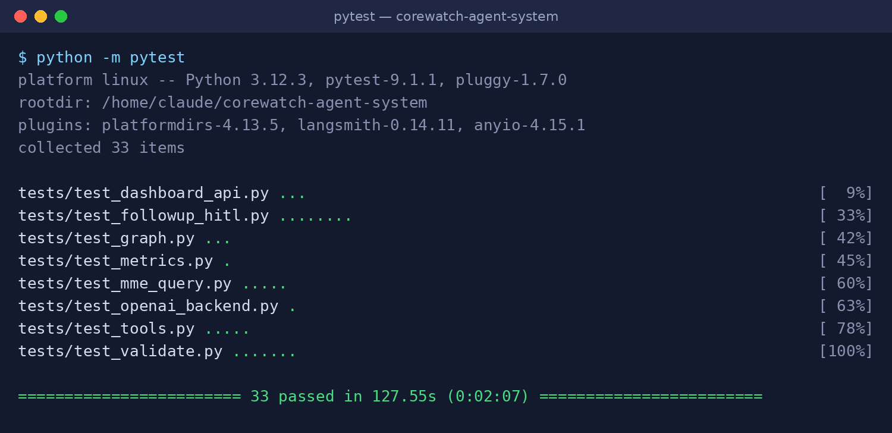</p>

| 파일 | 개수 | 확인 내용 |
|---|---|---|
| `test_mme_query.py` | 5 | 질문에서 장비 · 지표 · 시각 찾기 |
| `test_tools.py` | 5 | MCP 도구 응답 |
| `test_validate.py` | 7 | 자동 검사 (지어낸 숫자 · 없는 근거 번호 · 여러 장비 재시작 권고 반려) |
| `test_graph.py` | 3 | 전체 흐름, 일반 대화, 정보 부족 |
| `test_followup_hitl.py` | 8 | 이어지는 질문, 위험 조치 감지, 승인 대기 → 재개 |
| `test_openai_backend.py` | 1 | OpenAI 백엔드 연결 (가짜 응답, 과금 없음) |
| `test_metrics.py` | 1 | 운영 지표 집계 |
| `test_dashboard_api.py` | 3 | 관제 화면 API, SSE 스트림, LangSmith 설정 판별 |

### 2-5. 최종 실행 화면

여러 장비 동시 이상 알람을 눌러 분석한 최종 화면입니다. 왼쪽은 장비 9대 비교와 추이 그래프, 오른쪽은 AI 분석 패널(진행 단계 → 3구역 리포트 → 실행 기록 링크)입니다.


---

## 3. 느낀 점 및 향후 개선 사항

### 3-1. 프로젝트 수행 과정에서 느낀 점

- **AI에게 맡길 것과 맡기지 않을 것을 나누는 게 핵심이었습니다.** 처음에는 리포트 전체를 AI가 쓰게 했더니 데이터에 없는 숫자가 나왔습니다. 확인된 사실과 매뉴얼은 시스템이 그대로 옮기고, AI는 원인 추정만 쓰게 나누자 결과를 믿을 수 있게 됐습니다.
- **가짜 AI 테스트만으로는 알 수 없는 문제가 있었습니다.** 실제 gpt-4o로 돌려 보고서야 매뉴얼을 줘도 '장비 재시작'을 습관처럼 덧붙인다는 걸 알았습니다. 실제 모델로 반복 실행해 보는 검증이 꼭 필요하다는 걸 느꼈습니다.
- **탐지 성능은 숫자 하나로 정할 수 없었습니다.** 더 많이 찾을수록 잘못 울리는 알람도 늘었습니다. 운영 현장에서는 놓치는 것이 더 위험하다고 보고 탐지 쪽을 택했고, 그 대가를 숨기지 않고 기록했습니다.
- **실제 서비스처럼 보이게 하려면 화면과 운영 관리까지 필요했습니다.** 채팅창 하나로는 서비스로 느껴지지 않아 관제 대시보드와 LangSmith 실행 기록을 붙였고, 그 과정에서 '운영할 수 있는 AI'가 무엇인지 고민하게 됐습니다.

### 3-2. 구현 과정의 어려움 및 해결 경험

| 어려움 | 원인 | 해결 |
|---|---|---|
| 진행 표시가 `Called get_config outside of a runnable context` 오류로 실패 | Python 3.10에서는 LangGraph 비동기 노드에 실행 정보가 전달되지 않음 | Python 3.12로 고정, 3.11 이상 필수로 명시 |
| 매일 같은 시각 반복되는 정상 패턴까지 이상으로 잡힘 | "평소 같은 시간대"를 해당 시각 하나만 봐서 흔들림 | 앞뒤 1시간을 함께 보고, 다른 장비의 변동 폭을 하한으로 사용 |
| 성공률 지표가 0.1%만 흔들려도 알람 | 성공률은 평소 변동이 아주 작아 점수가 과하게 커짐 | 변동 폭 하한(scale floor) 적용 |
| AI가 사실에 없는 숫자를 만들어 냄 | LLM 특성 | 사실 · 매뉴얼은 시스템이 쓰고, AI 추정은 숫자 · 근거 번호 대조 후 재작성 |
| 실제 gpt-4o가 여러 장비 동시 이상에서도 "장비 재시작"을 권함 (6/6) | 매뉴얼을 받아도 일반적인 조치를 덧붙이는 경향 | 승인 단계가 먼저 막았고, 검사 규칙을 추가해 재작성 (2차 0/6) |
| 정답(이상 여부)이 모델 선택에 섞일 위험 | 같은 기간으로 고르고 평가하면 성능이 부풀려짐 | 시간 순서로 학습 / 선택 / 채점 분리, 채점은 1회만 |
| LangSmith 서버에 닿지 않으면 분석이 멈춤 | 기록 전송 대기 시간이 김 | 짧은 시간 제한 + 재시도 1회, 실패해도 분석은 계속 |
| Windows에서 설치 · 문서 읽기가 `cp949` 오류 | 한글 파일을 시스템 기본 인코딩으로 읽음 | 파일 읽기를 모두 `encoding="utf-8"`로 통일 |
| 실제 데이터가 외부로 나갈 위험 | 외부 AI · 실행 기록 서비스 사용 | 실제 데이터 + OpenAI/LangSmith 조합은 서버가 시작 거부, 데이터 파일은 Git 제외 |

### 3-3. 향후 추가하고 싶은 기능과 개선 방향

| 현재 한계 | 개선 방향 |
|---|---|
| 잘못 울린 알람이 많음 (3일간 66건) | 같은 시각 여러 장비 알람을 1건으로 묶기, 운영자 피드백으로 기준 조정 |
| 하루 패턴이 일정하지 않은 지표에서 놓침 (놓친 9건 중 6건) | 지표 유형별 모델 분리, 더 긴 기간 데이터 확보 |
| 실제 AI가 추정에 숫자를 거의 쓰지 않아, 숫자 검사가 실제 모델에서 작동한 사례가 없음 | 숫자 인용을 요구하고 문장 논리까지 대조 |
| 검사 규칙(재시작 반려 등)을 사람이 하나씩 추가 | 매뉴얼의 "하지 말 것" 문장을 규칙으로 자동 변환 |
| 승인 대기 상태와 운영 지표를 메모리에 보관 | SQLite · Redis 저장소, Prometheus 수집 |
| 시나리오 6종 · 데이터 7일 · 교육용 매뉴얼, 단일 사용자 로컬 실행 | 수 주 데이터 · 실제 매뉴얼 연동, 인증 · 다중 사용자 · Docker 배포 |

---

## 4. 실행 방법

**한 번에 실행 (권장)** — 가상환경 · 설치 · 서버 2개 · 브라우저까지 자동으로 켭니다. `.env`에 `OPENAI_API_KEY`가 있으면 실제 AI(OpenAI), 없으면 가짜 AI로 켜집니다.

| OS | 실행 |
|---|---|
| macOS | Finder에서 `sh/run_mac.command` 더블클릭 (또는 터미널에서 `./sh/run_mac.command`) |
| Windows | 탐색기에서 `sh\run_windows.bat` 더블클릭 |

이미 켜진 서버가 8100 · 8600 포트를 잡고 있으면 먼저 끄고 다시 켭니다. 서버 로그는 `logs/`에 남습니다.

**LangSmith 실행 기록 켜기 (선택, 합성 데이터에서만)** — `.env`에 아래 세 줄을 넣고 서버를 다시 켭니다.

```
LANGCHAIN_TRACING_V2=true
LANGCHAIN_API_KEY=lsv2_pt_...      # 본인 키
LANGCHAIN_PROJECT=corewatch
```

**직접 실행 — 설치 (처음 한 번)**

```powershell
# Windows PowerShell
uv venv -p 3.12 .venv
.venv\Scripts\activate
uv pip install -r requirements.txt
copy .env.example .env
```

```bash
# macOS / Linux
bash sh/setup_venv.sh && cp .env.example .env
```

**직접 실행 — 서버 (터미널 2개)**

```powershell
# 터미널 1 — 백엔드 (기본은 가짜 AI, 외부 호출 없음)
.venv\Scripts\python.exe server.py
# 실제 AI로 실행하려면 먼저:  $env:LLM_BACKEND="openai"   (.env에 OPENAI_API_KEY 필요, 합성 데이터에서만)

# 터미널 2 — 화면
.venv\Scripts\python.exe web_demo_server.py
# 브라우저에서 http://localhost:8600
```

- 알람 목록에서 알람을 누르거나, `MME-A03 pag_sms_succ_rate 2026-10-16 08:00 알람 원인 분석해줘`처럼 입력합니다.
- 이어서 `그 장비 짝 지표는?`, `같은 시각 MME-A05는?`처럼 물을 수 있습니다.

**테스트와 평가**

```powershell
.venv\Scripts\python.exe -m pytest -q                 # 단위 테스트 33개
.venv\Scripts\python.exe eval\run_scenarios.py        # 시나리오 6개 실행 점검 (가짜 AI)
$env:LLM_BACKEND="openai"; .venv\Scripts\python.exe eval\run_scenarios.py --repeat 3   # 실제 AI로 3회 반복
$env:DATA_MODE="original"; .venv\Scripts\python.exe eval\eval_detector.py   # 탐지 성능 평가 (실제 데이터 필요)
```

| `DATA_MODE` | 데이터 | 사용 범위 |
|---|---|---|
| `synthetic` (기본값) | 실제 데이터와 무관하게 새로 만든 합성 데이터 | 외부 AI, 실행 기록 서비스, 공개 시연 |
| `original` | 제공받은 실제 장비 데이터 (엑셀, 저장소에 없음) | 내 컴퓨터 안에서 로컬 AI 모델로만 |

---

## 5. 개발 환경 · 폴더 구조 · 데이터 사용 원칙

**개발 환경 및 기술 스택**

| 구분 | 사용 기술 |
|---|---|
| 언어 · 환경 | Python 3.12 (3.11 이상 필수), Windows 11 / macOS, uv 가상환경 |
| 백엔드 | FastAPI, Uvicorn, SSE(실시간 진행 표시), SQLite(대화 기록) |
| 에이전트 | LangGraph (StateGraph, 서브그래프, `interrupt` + checkpointer) |
| 도구 연결 | MCP (fastmcp, stdio) — Tool 6개 · Resource 2개 · Prompt 2개 |
| 이상 탐지 | scikit-learn Isolation Forest, pandas |
| 문서 검색(RAG) | 점검 매뉴얼 5종, TF-IDF 문자 n-gram (선택: Ollama 임베딩) |
| AI 모델 | OpenAI gpt-4o-mini(질문 분류) · gpt-4o(원인 추정) — 합성 데이터로 실측 / fake(테스트용) / Ollama(로컬, 코드만 연결) |
| 화면 | Vue 3 (CDN) 단일 HTML 관제 대시보드, 그래프는 외부 라이브러리 없이 SVG로 직접 그림 |
| 테스트 · 운영 | pytest 33개, 실제 모델 반복 실행 점검, `/metrics`, LangSmith (합성 데이터에서만) |

**폴더 구조**

```
mme/                데이터 읽기(data.py), 이상 탐지 모델(detect.py), 점검 매뉴얼 검색(rag.py)
mcp_server.py       AI가 부르는 도구 모음 (MCP)
agent/graph.py      에이전트 흐름 연결 (의존성 주입)
agent/deps.py       노드에 주입하는 의존성 묶음 (LLM · MCP · 세션 저장소)
agent/nodes/        흐름의 각 단계 (분류 · 계획 · 조사 · 판단 · 작성 · 검사 · 승인)
agent/subagents/    조사 담당 에이전트 3개 (각각 작은 LangGraph)
agent/observability.py  LangSmith 실행 기록 · 자동 피드백
agent/metrics.py    운영 지표 집계
agent/mme_query.py  질문에서 장비 · 지표 · 시각 찾기, 이어지는 질문 처리
data/runbooks_mme/  점검 매뉴얼 5종
data/synthetic/     합성 데이터와 일부러 넣은 이상 사례 목록
eval/               탐지 성능 평가, 시나리오 실행 점검
tests/              단위 테스트 (pytest)
server.py           백엔드 서버 (포트 8100)
web_chat.html       관제 대시보드 (web_demo_server.py로 실행, 포트 8600)
```

**데이터 사용 원칙**

- 실제 장비 데이터 파일(`*.xlsx`, `*.p`)은 저장소에 올리지 않습니다. 저장소 바깥의 `../Data/` 폴더에 두고 사용합니다.
- 실제 데이터로 실행할 때는 외부 AI 서비스와 실행 기록 서비스를 쓰지 않습니다.
- 데이터의 정답 표시(이상 여부)는 탐지 성능 채점에서만 읽습니다. 에이전트는 정답을 보지 않고 판단합니다.
- 화면 캡처, 시연, 실제 AI(OpenAI) 실행은 모두 합성 데이터로 했습니다.
